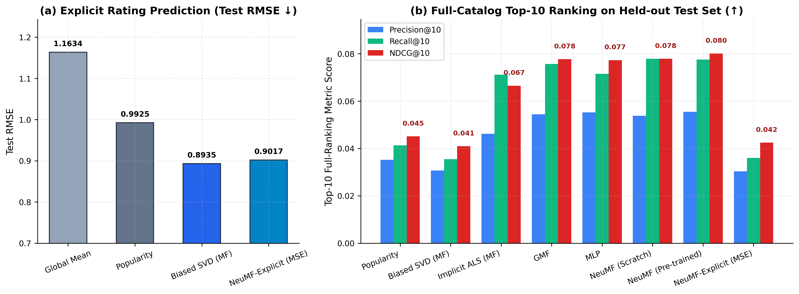
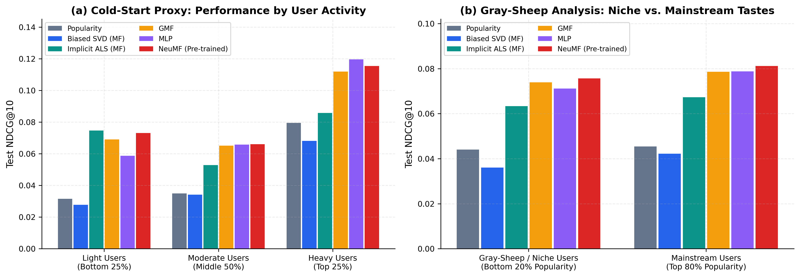

# Movie Recommendation on MovieLens-1M: Popularity vs. Matrix Factorization (SVD/ALS) vs. Neural Collaborative Filtering

An end-to-end, reproducible PyTorch study comparing classical **Heuristic Popularity**, linear **Matrix Factorization** (**Biased Funk-SVD** and **Implicit ALS**), and deep **Neural Collaborative Filtering** (**GMF**, **MLP**, **NeuMF Scratch**, **Pre-trained NeuMF**, and **NeuMF-Explicit**) on **MovieLens-1M** under a strict, leak-free per-user chronological split and full-catalog evaluation.

---

## 1. Project Overview & Key Findings

* **Dataset**: [MovieLens-1M](https://grouplens.org/datasets/movielens/1m/) — **1,000,209** explicit ratings (`1–5` stars) from **6,040** users across **3,883** movies (`95.74%` matrix sparsity; `57.52%` ratings ≥ 4 stars; top 20% most popular movies capture `65.2%` of all ratings).
* **Leak-Free Chronological Split (`80 / 10 / 10`)**: Every user's interactions are sorted by timestamp—oldest `80%` (`797,758`) → **Train**, next `10%` (`99,692`) → **Validation**, newest `10%` (`102,759`) → **Test** (`0%` future leakage verified by unit tests).
* **Main Headline Insights**:
  1. **Supervision Alignment Beats Model Complexity for Top-10 Ranking**: Explicit **Biased SVD** attains the lowest rating error (**Test RMSE = `0.8935`** vs. `0.9925` Popularity and `1.1634` Global Mean), yet scores lower than Popularity on Top-10 ranking (`NDCG@10 = 0.0410` vs. `0.0451`) due to Missing-Not-At-Random (MNAR) selection bias. Incorporating implicit negative feedback via **Implicit ALS** (`NDCG@10 = 0.0665`) or **Pre-trained NeuMF** (**`NDCG@10 = 0.0801`**, `+77.6%` over Popularity) resolves this gap.
  2. **Two-Stage Pre-Training Unlocks NeuMF**: Initializing **NeuMF** from converged **GMF** and **MLP** checkpoints (`α = 0.5`) achieves the best overall ranking (**`Precision@10 = 0.0555`**, **`NDCG@10 = 0.0801`**, **`HitRate@10 = 0.3470`**) while maintaining **`33.66%` catalog coverage** (`1,307` distinct recommended movies vs. only `116` for Popularity).
  3. **Tuned Implicit ALS Excels on Sparse Profiles & Diversity**: On the bottom-25% Light Users (*cold-start proxy*), **Implicit ALS** achieves the highest `NDCG@10` (**`0.0746`**) alongside the broadest catalog coverage (**`37.27%`**, `1,447` movies) and lowest Gini concentration (`0.8838`).



---

## 2. Repository Structure

```text
movie-recsys/
├── data/                        # MovieLens-1M raw files (downloaded via src/download_data.py)
├── demo/
│   └── app.py                   # Interactive Streamlit demo (side-by-side models & persona presets)
├── docs/
│   ├── presentation_5_slides.pptx             # 5-slide academic defense deck (English + Speaker Notes)
│   ├── presentation_5_slides.pdf              # Rendered PDF of academic 5-slide deck
│   ├── presentation_nontech_en_5_slides.pptx  # 5-slide plain-English non-technical deck
│   ├── presentation_nontech_en_5_slides.pdf   # Rendered PDF of plain-English non-tech deck
│   ├── presentation_nontech_5_slides.pptx     # 5-slide Vietnamese study & Q&A deck
│   ├── presentation_nontech_5_slides.pdf      # Rendered PDF of Vietnamese study deck
│   ├── presentation_5_slides.md               # Companion slide outline
│   ├── project_report.docx                    # 18-page academic technical report (Word)
│   ├── project_report.pdf                     # Rendered PDF technical report
│   └── project_report.tex                     # Overleaf-ready LaTeX summary
├── notebooks/
│   └── 01_movielens_experiments.ipynb  # Interactive EDA & qualitative inspection notebook
├── results/
│   ├── eda_summary.json         # Dataset statistics & long-tail ratios
│   ├── mf_grid_search.json      # 12-point Biased SVD hyperparameter grid results
│   ├── training_history.json    # Epoch-by-epoch Validation RMSE / NDCG@10 curves
│   ├── metrics.md / .json       # Held-out Test metrics table
│   ├── error_analysis.md / .json # Cohort & popularity-bias breakdown
│   └── figures/                 # 8 publication-grade 300-DPI PNG charts
├── saved_models/                # Trained PyTorch checkpoints (.pt)
├── src/
│   ├── download_data.py         # Resilient MovieLens-1M downloader
│   ├── data.py                  # Temporal split, sparse CSR matrices, vectorized loaders & neg sampling
│   ├── models.py                # Popularity, Biased SVD, Implicit ALS, GMF, MLP, NeuMF variants
│   ├── train.py                 # Training loops, grid search, early stopping, NeuMF pre-trained fusion
│   ├── metrics.py               # RMSE & exact full-catalog Precision@K, Recall@K, NDCG@K, HitRate@K
│   ├── evaluate.py              # Unified Test-set evaluation script
│   ├── error_analysis.py        # Cold-start, gray-sheep, popularity bias & Gini analysis
│   ├── plot_results.py          # Generates all 8 figures in results/figures/
│   ├── build_slides.py          # Generates the 5-slide PPTX deck
│   └── build_report.py          # Generates the 15-20 page academic report
├── tests/
│   └── test_pipeline.py         # Automated pytest suite (split integrity, math, checkpoints, UI)
└── requirements.txt
```

---

## 3. Setup & How to Run

### Installation & Dataset Acquisition
```bash
pip install -r requirements.txt
python -m src.download_data
```

### Training & Hyperparameter Tuning
Run the entire model suite (Biased SVD 12-config grid search, Implicit ALS tuning, GMF, MLP, Scratch NeuMF, Pre-trained NeuMF, and Explicit NeuMF) or train individual models:
```bash
# Train & tune all 7 models automatically
python -m src.train --model all --tune --epochs 18

# Or run models individually
python -m src.train --model mf --tune
python -m src.train --model als --tune
python -m src.train --model gmf --dim 64 --epochs 18
python -m src.train --model mlp --dim 64 --epochs 18
python -m src.train --model neumf --dim 64 --epochs 18
python -m src.train --model neumf_pretrained --dim 64 --epochs 15
python -m src.train --model neumf_explicit --dim 64 --epochs 18
```

### Evaluation, Error Analysis, Plots & Automated Tests
```bash
python -m src.evaluate          # -> results/metrics.md & results/metrics.json
python -m src.error_analysis    # -> results/error_analysis.md & results/error_analysis.json
python -m src.plot_results      # -> results/figures/*.png (8 figures @ 300 DPI)
python -m pytest tests/test_pipeline.py -v
```

### Launch the Live Demo (Streamlit)
```bash
streamlit run demo/app.py
```
The demo (`demo/app.py`) allows selecting any User ID (`0–6039`) or curated persona (*Active Mainstream Fan*, *Heavy Cinephile*, *Light / Cold-Start User*, *Gray-Sheep / Niche User*), adjusting `Top-K`, inspecting historical favorites (`≥ 4★`), comparing Top-K recommendations side-by-side with verified Test-set hits (`✅`), and viewing pairwise Jaccard overlap and aggregate benchmark charts.

---

## 4. Experimental Results (Held-Out Test Set)

All Top-10 metrics use **exact full-catalog ranking** over every unseen movie (`3,883` candidates minus `Train + Val` history), treating Test items rated `≥ 4` as ground-truth positives. Note that implicit BCE/ALS models output ranking scores rather than `1–5` star predictions (marked `—` under RMSE), while `NeuMF-Explicit (MSE)` provides a direct neural star-rating counterpart.

| Model | Paradigm | RMSE ↓ | Precision@10 ↑ | Recall@10 ↑ | NDCG@10 ↑ | HitRate@10 ↑ |
|:---|:---|:---:|:---:|:---:|:---:|:---:|
| Global Mean | Baseline | 1.1634 | — | — | — | — |
| Popularity (IMDB WR) | Heuristic | 0.9925 | 0.0352 | 0.0413 | 0.0451 | 0.2279 |
| **Biased SVD (MF)** | Explicit | **0.8935** | 0.0307 | 0.0355 | 0.0410 | 0.2094 |
| Implicit ALS (MF) | Implicit | — | 0.0462 | 0.0711 | 0.0665 | 0.3195 |
| GMF | Implicit | — | 0.0544 | 0.0757 | 0.0777 | 0.3407 |
| MLP | Implicit | — | 0.0553 | 0.0715 | 0.0773 | 0.3425 |
| NeuMF (Scratch) | Implicit | — | 0.0538 | **0.0779** | 0.0779 | 0.3456 |
| **NeuMF (Pre-trained)** | Implicit | — | **0.0555** | 0.0775 | **0.0801** | **0.3470** |
| NeuMF-Explicit (MSE) | Explicit | 0.9017 | 0.0304 | 0.0360 | 0.0425 | 0.2035 |

---

## 5. Short Error & Bias Analysis

Full tables and plots are available in [`results/error_analysis.md`](results/error_analysis.md) and [`results/figures/`](results/figures/). Key takeaways across user cohorts and catalog diversity:

| Model | Light Users (NDCG@10) | Heavy Users (NDCG@10) | Gray-Sheep Niche (NDCG@10) | Top-10% Head Share | Catalog Coverage | Gini Index | Zero-Hit Rate |
|:---|:---:|:---:|:---:|:---:|:---:|:---:|:---:|
| Popularity | 0.0315 | 0.0795 | 0.0441 | 97.81% | 2.99% (116 movies) | 0.9953 | 77.21% |
| Biased SVD (MF) | 0.0277 | 0.0681 | 0.0360 | 60.31% | 31.78% (1,234 movies) | 0.9460 | 79.06% |
| Implicit ALS (MF) | **0.0746** | 0.0857 | 0.0633 | 74.93% | **37.27% (1,447 movies)** | **0.8838** | 68.05% |
| GMF | 0.0690 | 0.1118 | 0.0739 | 85.19% | 32.60% (1,266 movies) | 0.9230 | 65.93% |
| MLP | 0.0587 | **0.1195** | 0.0712 | 96.36% | 19.34% (751 movies) | 0.9651 | 65.75% |
| **NeuMF (Pre-trained)** | 0.0730 | 0.1155 | **0.0757** | 84.81% | 33.66% (1,307 movies) | 0.9212 | **65.30%** |

1. **Cold-Start Proxy (User Activity Stratification)**: MovieLens-1M enforces ≥ 20 total ratings per user, so we use the bottom-25% training-count quartile (`1,480` users) as a cold-start proxy. Under scarce histories, standalone **MLP** drops noticeably (`NDCG@10 = 0.0587`) due to under-trained deep parameters, whereas closed-form **Implicit ALS** (`0.0746`) and **Pre-trained NeuMF** (`0.0730`) provide strong regularization and more than double Popularity (`0.0315`). For heavy users (`1,448` users), neural models leverage rich interaction histories to surge ahead (`MLP = 0.1195`, `NeuMF Pre-trained = 0.1155`).
2. **Gray-Sheep / Niche Users**: For the `20%` of users (`1,158` users) whose positive history concentrates on less popular films, non-personalized Popularity struggles (`NDCG@10 = 0.0441`) and Explicit Biased SVD underperforms (`0.0360`). **Pre-trained NeuMF** achieves `0.0757` (`+71.7%` over Popularity) and hits specific long-tail user tastes (e.g., ranking *Return to Me (2000)* at Rank #1 for Gray-Sheep User `#5333`, while Popularity and Biased SVD score `0/5`).
3. **Popularity Bias vs. Coverage**: Popularity exhibits near-total monopoly (`97.81%` top-10% head share, `2.99%` catalog coverage, Gini `0.9953`). Interestingly, standalone **MLP** achieves high precision partly by mimicking popularity (`96.36%` head share, `19.34%` coverage), whereas **GMF** (`32.60%`), **Pre-trained NeuMF** (`33.66%`), and **Implicit ALS** (`37.27%`) expand long-tail discovery over **11x–12x** while simultaneously lowering complete-miss failure rates (`Zero-Hit Rate` down from `77.2%` to `65.3%`).
4. **Explicit-vs-Implicit MNAR Paradox**: Without negative sampling or full-matrix confidence weighting, explicit MSE models (`Biased SVD`, `NeuMF-Explicit`) inflate predicted scores for obscure movies rated `5/5` by tiny niches, degrading Top-10 ranking despite strong RMSE (`0.8935`).



---

## 6. References

1. F. M. Harper & J. A. Konstan (2015). *The MovieLens Datasets: History and Context*. ACM TiiS.
2. Y. Koren, R. Bell, & C. Volinsky (2009). *Matrix Factorization Techniques for Recommender Systems*. IEEE Computer.
3. Y. Hu, Y. Koren, & C. Volinsky (2008). *Collaborative Filtering for Implicit Feedback Datasets*. IEEE ICDM.
4. X. He et al. (2017). *Neural Collaborative Filtering*. WWW 2017.
5. P. Cremonesi, Y. Koren, & R. Turrin (2010). *Performance of Recommender Algorithms on Top-N Recommendation Tasks*. ACM RecSys.
6. M. Ferrari Dacrema, P. Cremonesi, & D. Jannach (2019). *Are We Really Making Much Progress? A Worrying Analysis of Recent Neural Recommendation Approaches*. ACM RecSys.
